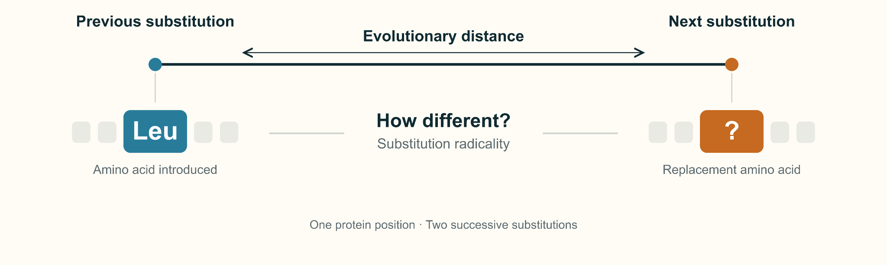
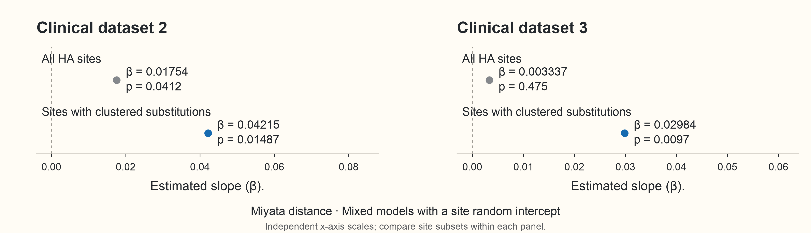

# Amino-acid substitution radicality in influenza A/H3N2

**Does an amino-acid substitution become more chemically radical when more
evolutionary distance has elapsed since the previous substitution at the same site?**

We study this question in hemagglutinin (HA), the influenza surface protein
involved in host-cell entry. The analysis compares three sequence datasets and
three groups of sites, using linear regression and linear mixed models to
account for differences between protein positions.

This repository contains the analysis code and the 2026 MSc thesis by
Appolinaria Prokopovich. The analysis examines site heterogeneity, parallel
evolution, and the influence of laboratory passage on substitution radicality.

[Main findings](#main-findings) · [Study design](#study-design) ·
[Run the analysis](#run-the-analysis) · [Repository guide](#repository-guide) ·
[Full thesis in Russian](thesis/Prokopovich_2026_MSc_thesis_ru.pdf)



## Main findings

- **Accounting for site changes the result.** In the two clinical datasets,
  an analysis across all sites gives no consistent distance–radicality trend
  after allowing each site to have its own baseline radicality.
- **Sites with clustered substitutions show a repeated positive trend.**
  Radicality increases with evolutionary distance in both clinical datasets
  after accounting for site, with both Grantham and Miyata distances.
- **Senescent sites behave differently across datasets.** A negative trend
  appears in the dataset containing laboratory-passaged sequences, while
  neither clinical dataset shows a significant effect in the site model.

The positive trend at clustered sites loses significance when parental amino
acid is also included as a random effect nested within site. Its interpretation
therefore depends on the model and the observations retained for fitting.
Numerical results and the laboratory-passage analysis are described in the
results guide. [Results and interpretation](results/README.md)



*Distance coefficients from models with a site random intercept. The positive
association at clustered sites occurs in both clinical datasets. Each panel
uses its own scale and distance units.*

## Study design

### What is measured

Radicality measures the physicochemical difference between two amino acids.
Miyata distance uses polarity and volume. Grantham distance also includes
side-chain composition. Higher values mean a more radical substitution.

For two successive substitutions at the same position along a lineage, the
analysis follows three amino-acid states.

```text
grandanc_aa  →  anc_aa  →  der_aa
              first      next substitution

predictor   evolutionary distance between the two substitution events
response    radicality of anc_aa → der_aa
```

The extraction script measures distance from the descendant node of the first
substitution to the midpoint of the branch carrying the next substitution.
Branch lengths determine its units. The data guide documents the input files
and every output column. [Data format](data/README.md)

### Three datasets, three site groups

| Dataset | Sequence source | Tree and ancestral reconstruction | Distance units |
|---|---|---|---|
| D1 | Clinical and laboratory-passaged | FastTree (GTR+G) / MEGA | Expected substitutions per site |
| D2 | Clinical only | FastTree (GTR+G) / MEGA | Expected substitutions per site |
| D3 | Clinical only, 2004–September 2025 | TreeTime, rooted on a 1968 isolate | Years |

Laboratory-passaged sequences come from viruses propagated in culture, including
chicken embryos. Comparing D1 with the clinical datasets helps assess how
laboratory adaptation may influence the observed trends. D2 and D3 also provide
a comparison across tree-building methods. Their different distance units
require interpreting slopes on each dataset's own scale.

Each dataset is analysed for all sites and for two subsets, giving nine
dataset–subset combinations.

| Site group | Definition |
|---|---|
| All sites | All sites represented in the substitution-pair table |
| Sites with clustered substitutions | Parallel changes from the same ancestral amino acid to the same derived amino acid occur closer together on the tree than divergent changes, following Klink and Bazykin (2017), FDR < 0.1 |
| Senescent sites | The probability of replacing an amino acid increases with time since it appeared, following Popova et al. (2019) |

Subset assignments come from upstream analyses. The thesis describes their
methods and references. [Full methods](thesis/Prokopovich_2026_MSc_thesis_ru.pdf)

### Models

For each radicality metric, the R script fits three specifications. In the
formulas below, `radicality` stands for `gr_rad_anc` or `miyata_rad`.

| Model | R formula | Purpose |
|---|---|---|
| Linear regression | `radicality ~ distance` | Estimate the overall association |
| Site random intercept | `radicality ~ distance + (1 \| site)` | Allow baseline radicality to vary between sites |
| Parental amino acid nested within site | `radicality ~ distance + (1 \| site / anc_aa)` | Also allow baseline differences between parental amino acids within a site |

Comparing linear regression with the site model shows how differences between
positions affect the estimated trend. The nested model additionally accounts
for parental amino-acid context within each site.

## Run the analysis

Run the commands from the repository root. You will need Python 3.10 or later,
R with the required packages, and your own authorised input data. R 4.4 or later
is recommended for current CRAN versions of the dependencies.

### 1. Install dependencies

With [uv](https://docs.astral.sh/uv/), install Python dependencies and the R
packages used by the project.

```bash
uv sync --extra notebooks --extra test
Rscript scripts/install_r_dependencies.R
```

For a pip installation, create a virtual environment and install
`requirements.txt`. Use `python` in place of `uv run python` in the commands
below.

```bash
python3 -m venv .venv
source .venv/bin/activate
python -m pip install -r requirements.txt
Rscript scripts/install_r_dependencies.R
```

### 2. Prepare inputs

Place a named Newick tree at `data/raw/tree.newick` and an aligned, in-frame
nucleotide FASTA at `data/raw/ancestral_sequences.fasta`. Every leaf and internal
tree node must have a matching sequence. If you already have an annotated
substitution-pair table, you can start at the model-fitting step.

The study uses GISAID EpiFlu data, which are obtained separately under its access
terms. The local input requirements and redistribution policy are documented
here. [Data format](data/README.md) · [Data policy](DATA_POLICY.md)

### 3. Extract substitution pairs and calculate radicality

```bash
uv run python scripts/extract_substitution_pairs.py \
  data/raw/tree.newick \
  data/raw/ancestral_sequences.fasta \
  data/processed/substitution_pairs.csv

uv run python scripts/add_radicality.py \
  data/processed/substitution_pairs.csv \
  data/processed/substitution_pairs_radicality.csv
```

Radicality is calculated from AAindex records `GRAR740104` (Grantham) and
`MIYT790101` (Miyata). Output directories are created automatically.

### 4. Fit the models

```bash
Rscript R/fit_radicality_models.R \
  data/processed/substitution_pairs_radicality.csv \
  results/tables/model_summary.csv
```

Run this command separately for each dataset and site subset, supplying its
prepared CSV and a distinct output path. A successful run writes six summary
rows, one for each combination of metric and model. The output includes the
distance coefficient, standard error, p-value, sample size, R², AIC, BIC,
REML criterion, and a singular-fit flag.

The script removes incomplete observations, retains sites with at least three
observations for the site model, and retains site–parental-amino-acid groups
with at least three observations for the nested model. Sample sizes can
therefore differ between models. Check the output `n` when comparing fits.

Tree construction, ancestral reconstruction, site-subset identification, and
the EpiStat passage-association analysis were performed upstream. The research
notebooks and exploratory R scripts document those study-specific steps.

## Repository guide

| Location | What you will find |
|---|---|
| [scripts/extract_substitution_pairs.py](scripts/extract_substitution_pairs.py) | Named tree and ancestral sequences → successive substitution pairs |
| [scripts/add_radicality.py](scripts/add_radicality.py) | Substitution pairs → Grantham and Miyata distances |
| [R/fit_radicality_models.R](R/fit_radicality_models.R) | Annotated pairs → fixed and mixed-model summaries |
| [data/](data/README.md) | Input requirements, table schema, and local data layout |
| [results/](results/README.md) | Findings, numerical results, and the retained tree-coverage figure |
| [notebooks/](notebooks/README.md) | Original extraction, distance-checking, and passage-category notebooks |
| [R/exploratory/](R/exploratory/README.md) | Interactive research scripts and their known limitations |
| [scripts/make_itol_site_annotation.py](scripts/make_itol_site_annotation.py) | Amino-acid colour strips for iTOL |
| [scripts/make_itol_branch_colors.py](scripts/make_itol_branch_colors.py) | Substitution branches and labels for iTOL |
| [scripts/tree_summary.py](scripts/tree_summary.py) | Leaf and internal-node counts |
| [tests/](tests/) | Tests of the reusable Python analysis |
| [thesis/](thesis/Prokopovich_2026_MSc_thesis_ru.pdf) | Submitted MSc thesis in Russian |

## Tests

```bash
uv run --extra test python -m pytest
```

The tests exercise FASTA normalization, codon translation, substitution-pair
extraction, distance calculation, and radicality annotation using small test
inputs. Reproducing the study-level estimates requires the restricted inputs
and the corresponding preprocessing choices.

## License

The software is released under the [MIT License](LICENSE). Copyright in the
thesis PDF belongs to Appolinaria Prokopovich and is separate from the software
license.
