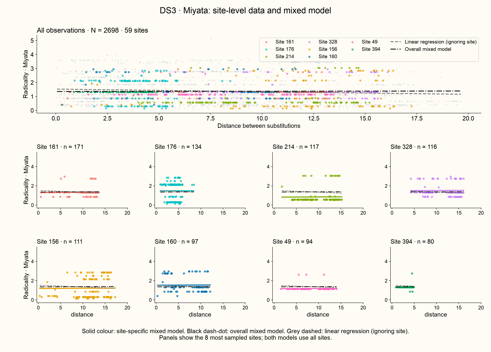

# Results and interpretation

The study asks how substitution radicality changes with evolutionary distance
in influenza A/H3N2 hemagglutinin. This overview summarizes the model
comparisons and laboratory-passage association analysis reported in the thesis. [Project overview](../README.md)

## Main comparison

The table summarizes the Miyata results for the model
`miyata_rad ~ distance + (1 | site)`. Each cell gives the distance coefficient
β and its p-value.

| Site group | D1, clinical + laboratory | D2, clinical | D3, clinical |
|---|---|---|---|
| All sites | β = −1.694, p = 1.22 × 10⁻⁵ | β = +0.017, p = 0.041 | β = +0.003, p = 0.475 |
| Sites with clustered substitutions | β = −0.597, p = 0.781 | β = +0.042, p = 0.015 | β = +0.030, p = 0.010 |
| Senescent sites | β = −2.821, p = 1.19 × 10⁻⁴ | β = +0.018, p = 0.274 | β = −0.004, p = 0.652 |

D1 and D2 measure evolutionary distance in expected substitutions per site.
D3 uses years. Interpret the coefficient magnitudes within their respective
units.

Across all sites, the two clinical datasets give different outcomes after
accounting for site. In D2, the Miyata slope changes from −0.007 (p = 0.277)
in linear regression to +0.017 (p = 0.041) in the site model. In D3, it changes
from −0.016 (p = 1.31 × 10⁻⁵) to +0.003 (p = 0.475). This illustrates how
variation between sites affects the estimated distance trend.

The positive association at sites with clustered substitutions repeats in
both clinical datasets and with both radicality metrics. In the thesis,
adding parental amino acid nested within site makes this association
non-significant. Possible explanations include residual differences between
parental-amino-acid contexts and reduced power in the smaller retained groups.
The model-specific sample sizes matter when interpreting this change.

At senescent sites, the negative association in D1 is absent from both clinical
datasets. Laboratory adaptation is a possible explanation for this difference.
The thesis contains the full comparisons for Grantham and Miyata.
[Thesis, results and appendix tables](../thesis/Prokopovich_2026_MSc_thesis_ru.pdf)

## How site heterogeneity affects the fit

The top panel shows all 2,698 observations retained for the site model across
59 sites. The lower panels show the eight most sampled sites. Coloured lines
include each site's random intercept and share a common slope. The black
line shows the fixed part of the mixed model, and the grey dashed line shows
pooled linear regression. Evolutionary distance is measured in years.

For this illustration, both models use the same 2,698 observations. The pooled
regression therefore uses a smaller sample than the 2,744-observation regression
in the supplementary table. The figure was fitted with Python statsmodels
using REML for the mixed model.

## Dataset sizes

| Dataset | Substitution pairs | Sites |
|---|---:|---:|
| D1 | 2,492 | 125 |
| D2 | 1,293 | 53 |
| D3 | 2,744 | 95 |

Model-specific sample sizes follow the supplementary tables. For the full D3
analysis, Table 4 (p. 55) reports 2,744 observations for linear regression,
2,698 for the site model, and 2,697 for the nested model, for both radicality
metrics. Use the sample size recorded for each fit when reproducing an estimate.
[Thesis supplementary tables](../thesis/Prokopovich_2026_MSc_thesis_ru.pdf)

## Laboratory-passage association analysis

The D1 tree contains 2,711 leaves, comprising 1,586 clinical and 1,125
laboratory-passaged sequences. Each node was assigned a binary passage
phenotype. Phenotype changes were encoded as substitutions at a pseudo-site
in an XPARR file, and EpiStat tested associations between substitutions at
protein sites and phenotype changes along branches against a permutation null.
The thesis describes this analysis in section 3.3.

Two disjoint classes of sites were reported.

| Class | Definition | Sites |
|---|---|---|
| Concordant sites | Substitutions coincide with the transition to laboratory culture | 17, 176, 202, 210, 238, 241, 364, 380, 530 |
| R-sites | More than 60% of substitutions fall on laboratory branches | 171, 183, 217, 236, 242, 245, 377, 391, 440, 441, 454, 455, 466, 468, 558 |

The thesis reports that removing these sites weakened the negative trend while
leaving a residual effect, suggesting a broader contribution of laboratory
adaptation. [Thesis](../thesis/Prokopovich_2026_MSc_thesis_ru.pdf)

## Files and generated output

| Figure | Content |
|---|---|
| [Substitution radicality](figures/substitution_radicality_concept.png) | Conceptual diagram of two successive substitutions at one position |
| [Clustered-substitution regressions](figures/clustered_trends_Miyata.png) | Observations, fitted Miyata trends, and 95% confidence bands at clustered sites in D2 and D3 |
| [Site heterogeneity in D3](figures/site_heterogeneity_D3_Miyata.png) | Pooled regression and mixed-model predictions with individual-site panels |
| [Tree-coverage comparison](figures/tree_coverage_comparison.pdf) | Coverage of the phylogenetic trees used in the analysis |

The conceptual diagram is reused from the project's presentation assets. The
clustered-substitution regressions come from the 2026 annual report. Their blue
lines show the fixed-effect trend of a model with a site random intercept, and
the bands show pointwise 95% confidence intervals for the mean response. The
site-heterogeneity figure comes from the project's regression-comparison analysis.

Write local model summaries to `results/tables/`. This directory is excluded
from version control under the repository's data policy.
[Data policy](../DATA_POLICY.md)

A successful run of `R/fit_radicality_models.R` produces six rows, covering two
metrics and three model specifications.

| Output columns | Meaning |
|---|---|
| `response`, `model` | Radicality metric and model specification |
| `n` | Number of observations retained for that fit |
| `estimate`, `std_error` | Distance coefficient and its standard error |
| `degrees_freedom`, `statistic`, `p_value` | Test of the distance coefficient |
| `r_squared_marginal`, `r_squared_conditional` | Fixed-effect and total explained variance for mixed models, ordinary R² in both columns for linear regression |
| `aic`, `bic`, `reml_criterion` | Fit criteria, with REML reported for mixed models |
| `singular` | Whether the mixed-model fit is singular |

Mixed-model R² is reported as `NA` when MuMIn is unavailable or its calculation
fails. Differences in retained observations limit direct comparisons of fit
criteria across model specifications.
